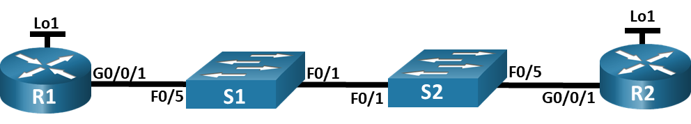

# Лабораторная работа 10 - Настройка протокола OSPFv2 для одной области
### Топология

### Таблица адресации

| Устройство  | Интерфейс   |  IP-адрес            | Маска подсети       | 
|-------------|-------------|----------------------|---------------------|
| R1          | G0/0/1      | 10.53.0.1            |  255.255.255.0      |
|             | Loop1       | 172.16.1.1           |  255.255.255.0      |
| R2          | G0/0/1      | 10.53.0.2            |  255.255.255.0      |
|             | Loop1       | 192.168.1.1          |  255.255.255.0      |
  
### Цели
Часть 1. Создание сети и настройка основных параметров устройства  
Часть 2. Настройка и проверка базовой работы протокола  OSPFv2 для одной области  
Часть 3. Оптимизация и проверка конфигурации OSPFv2 для одной области  
