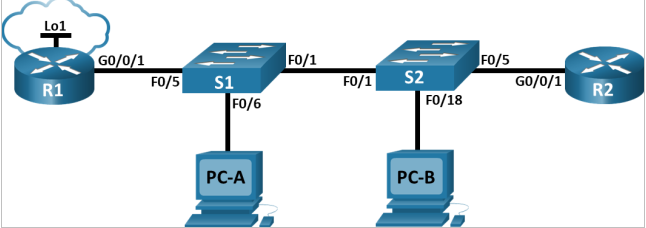

# Лабораторная работа 11 - Настройка и проверка расширенных списков контроля доступа.
### Топология



### Таблица адресации

| Устройство | Интерфейс | IP-адрес | Маска подсети | Шлюз по умолчанию |
|------------|-----------|----------|---------------|-------------------|
| R1         | G0/0/1    | —        | —             | —                 |
| R1         | G0/0/1.20 | 10.20.0.1| 255.255.255.0 | —                 |
| R1         | G0/0/1.30 | 10.30.0.1| 255.255.255.0 | —                 |
| R1         | G0/0/1.40 | 10.40.0.1| 255.255.255.0 | —                 |
| R1         | G0/0/1.1000| —       | —             | —                 |
| R1         | Loopback1 | 172.16.1.1| 255.255.255.0| —                 |
| R2         | G0/0/1    | 10.20.0.4| 255.255.255.0 | —                 |
| S1         | VLAN 20   | 10.20.0.2| 255.255.255.0 | 10.20.0.1         |
| S2         | VLAN 20   | 10.20.0.3| 255.255.255.0 | 10.20.0.1         |
| PC-A       | NIC       | 10.30.0.10| 255.255.255.0| 10.30.0.1         |
| PC-B       | NIC       | 10.40.0.10| 255.255.255.0| 10.40.0.1         |

### Таблица VLAN

| VLAN | Имя | Назначенный интерфейс |
|------|-----|-----------------------|
| 20   | Management | S2: F0/5 |
| 30   | Operations | S1: F0/6 |
| 40   | Sales | S2: F0/18 |
| 999  | ParkingLot | S1: F0/2-4, F0/7-24, G0/1-2<br>S2: F0/2-4, F0/6-17, F0/19-24, G0/1-2 |
| 1000 | Собственная | — |

### Задачи
Часть 1. Создание сети и настройка основных параметров устройства
Часть 2. Настройка и проверка списков расширенного контроля доступа

### Решение
### 1.Создание сети и настройка основных параметров устройства
Базовая настройка R1

```
en
conf t
hostname R1
no ip domain-lookup
enable secret class
line console 0
password cisco
login
line vty 0 4
password cisco
login
service password-encryption
banner motd # NO ENTER! #
end
write memory
```


Базовая настройка R2
```
en
conf t
hostname R2
no ip domain-lookup
enable secret class
line console 0
password cisco
login
line vty 0 4
password cisco
login
service password-encryption
banner motd # NO ENTER! #
end
write memory
```

Базовая настройка S1
```
en
conf t
hostname S1
no ip domain-lookup
enable secret class
line console 0
password cisco
login
line vty 0 4
password cisco
login
service password-encryption
banner motd # NO ENTER! #
end
write memory
```

Базовая настройка S2
```
en
conf t
hostname S2
no ip domain-lookup
enable secret class
line console 0
password cisco
login
line vty 0 4
password cisco
login
service password-encryption
banner motd # NO ENTER! #
end
write memory

```

### Часть 2. Настройка сетей VLAN на коммутаторах.
S1 — VLAN + Management + ParkingLot

```
configure terminal
vlan 20
 name Management
vlan 30
 name Operations
vlan 40
 name Sales
vlan 999
 name ParkingLot
vlan 1000
 name Native
exit
interface vlan 20
 ip address 10.20.0.2 255.255.255.0
 no shutdown
exit
ip default-gateway 10.20.0.1
interface range f0/2-4, f0/7-24, g0/1-2
 switchport mode access
 switchport access vlan 999
 shutdown
exit
interface f0/6
 switchport mode access
 switchport access vlan 30
 no shutdown
exit
interface f0/5
 switchport mode trunk
 no shutdown
exit
interface f0/1
 switchport mode trunk
 no shutdown
exit
end
write memory
```

S2 — VLAN + Management + ParkingLot
```
configure terminal
vlan 20
 name Management
vlan 30
 name Operations
vlan 40
 name Sales
vlan 999
 name ParkingLot
vlan 1000
 name Native
exit
interface vlan 20
 ip address 10.20.0.3 255.255.255.0
 no shutdown
exit
ip default-gateway 10.20.0.1
interface range f0/2-4, f0/6-17, f0/19-24, g0/1-2
 switchport mode access
 switchport access vlan 999
 shutdown
exit
interface f0/18
 switchport mode access
 switchport access vlan 40
 no shutdown
exit
interface f0/5
 switchport mode access
 switchport access vlan 20
 no shutdown
exit
interface f0/1
 switchport mode trunk
 no shutdown
exit
end
write memory
```
### Настройте транки (магистральный каналы)
S1 — транк F0/1 и F0/5
```
configure terminal
interface f0/1
 switchport mode trunk
 switchport trunk native vlan 1000
 switchport trunk allowed vlan 20,30,40,1000
exit
interface f0/5
 switchport mode trunk
 switchport trunk native vlan 1000
 switchport trunk allowed vlan 20,30,40,1000
exit
end
write memory
```

S2 — транк F0/1
```
configure terminal
interface f0/1
 switchport mode trunk
 switchport trunk native vlan 1000
 switchport trunk allowed vlan 20,30,40,1000
exit
end
write memory
```
### Часть 4. Настройте маршрутизацию

Маршрутизация на R1 (router-on-a-stick)
```
configure terminal
interface g0/0/1
 no shutdown
exit
interface g0/0/1.20
 encapsulation dot1Q 20
 ip address 10.20.0.1 255.255.255.0
 description Management
exit
interface g0/0/1.30
 encapsulation dot1Q 30
 ip address 10.30.0.1 255.255.255.0
 description Operations
exit
interface g0/0/1.40
 encapsulation dot1Q 40
 ip address 10.40.0.1 255.255.255.0
 description Sales
exit
interface g0/0/1.1000
 encapsulation dot1Q 1000 native
 description Native VLAN
exit
interface loopback 1
 ip address 172.16.1.1 255.255.255.0
 no shutdown
exit
end
write memory

```

R2 — интерфейс + маршрут по умолчанию
```
configure terminal
interface g0/0/1
 ip address 10.20.0.4 255.255.255.0
 no shutdown
exit
ip route 0.0.0.0 0.0.0.0 10.20.0.1
end
write memory

```

### Часть 5. Настройте удаленный доступ

На R1
```
configure terminal
username SSHadmin privilege 15 secret $cisco123!
ip domain-name ccna-lab.com
crypto key generate rsa modulus 1024
line vty 0 4
 transport input ssh
 login local
exit
ip http secure-server
ip http authentication local
end
write memory
```
R2, S1, S2 — аналогично (SSH)

```
configure terminal
username SSHadmin privilege 15 secret $cisco123!
ip domain-name ccna-lab.com
crypto key generate rsa modulus 1024
line vty 0 4
 transport input ssh
 login local
exit
end
write memory

```
### Часть 6. Настройка ПК

PC-A: IP 10.30.0.10 / 255.255.255.0, шлюз 10.30.0.1  
PC-B: IP 10.40.0.10 / 255.255.255.0, шлюз 10.40.0.1  

### Часть 7. Настройка и проверка списков контроля доступа (ACL)

ACL на R1 — для Sales 

```
configure terminal
ip access-list extended SALES_IN
 deny tcp 10.40.0.0 0.0.0.255 10.20.0.0 0.0.0.255 eq 22
 deny tcp 10.40.0.0 0.0.0.255 10.20.0.0 0.0.0.255 eq 80
 deny tcp 10.40.0.0 0.0.0.255 10.20.0.0 0.0.0.255 eq 443
 deny tcp 10.40.0.0 0.0.0.255 host 10.20.0.1 eq 80
 deny tcp 10.40.0.0 0.0.0.255 host 10.20.0.1 eq 443
 deny tcp 10.40.0.0 0.0.0.255 host 10.30.0.1 eq 80
 deny tcp 10.40.0.0 0.0.0.255 host 10.30.0.1 eq 443
 deny tcp 10.40.0.0 0.0.0.255 host 10.40.0.1 eq 80
 deny tcp 10.40.0.0 0.0.0.255 host 10.40.0.1 eq 443
 deny icmp 10.40.0.0 0.0.0.255 10.30.0.0 0.0.0.255 echo
 deny icmp 10.40.0.0 0.0.0.255 10.20.0.0 0.0.0.255 echo
 permit ip any any
exit
interface g0/0/1.40
 ip access-group SALES_IN in
exit
end
write memory
```
ACL на R1 — для Operations
```
configure terminal
ip access-list extended OPS_IN
 deny icmp 10.30.0.0 0.0.0.255 10.40.0.0 0.0.0.255 echo
 permit ip any any
exit
interface g0/0/1.30
 ip access-group OPS_IN in
exit
end
write memory

```

PC-A → Ping → 10.40.0.10  → Сбой  
PC-A → Ping → 10.20.0.1   → Успех  
PC-B → Ping → 10.30.0.10  → Сбой  
PC-B → Ping → 10.20.0.1   → Сбой  
PC-B → Ping → 172.16.1.1  → Успех  
PC-B → HTTPS → 10.20.0.1  → Сбой  
PC-B → HTTPS → 172.16.1.1 → Успех  
PC-B → SSH → 10.20.0.4    → Сбой  
PC-B → SSH → 172.16.1.1   → Успех  
