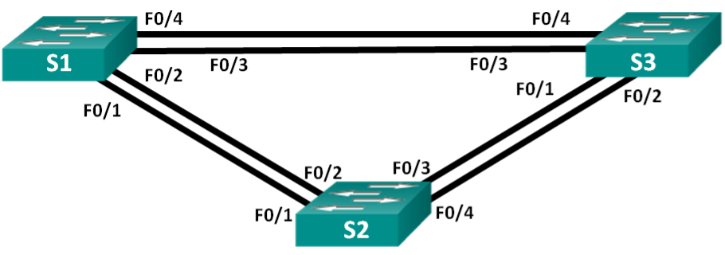
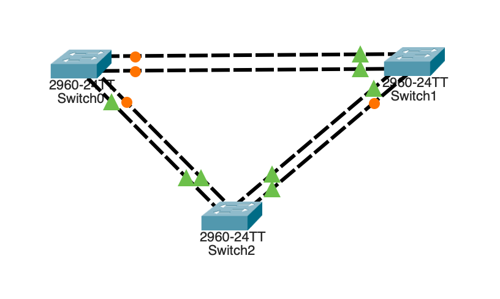

# Лабораторная работа 7. Развертывание коммутируемой сети с резервными каналами
### Топология


### Таблица адресации
| Устройство  | Интерфейс   |  IP-адрес            | Маска подсети       | 
|-------------|-------------|----------------------|---------------------|
| S1          | VLAN1       | 192.168.1.1          | 255.255.255.0       | 
| S2          | VLAN1       | 192.168.1.2          | 255.255.255.0       | 
| S3          | VLAN1       | 192.168.1.3          | 255.255.255.0       | 

### Цели 
#### Часть 1. Создание сети и настройка основных параметров устройства
#### Часть 2. Выбор корневого моста
#### Часть 3. Наблюдение за процессом выбора протоколом STP порта, исходя из стоимости портов
#### Часть 4. Наблюдение за процессом выбора протоколом STP порта, исходя из приоритета портов


### Решение:
#### Часть 1. Создание сети и настройка основных параметров устройства
#### Шаг 1:	Создайте сеть согласно топологии


#### Шаг 2:	Настройте базовые параметры каждого коммутатора.
Настройка для S1:

```
Switch> enable
Switch# configure terminal
Switch(config)# no ip domain-lookup
Switch(config)# hostname S1
S1(config)# enable secret class
S1(config)# line console 0
S1(config-line)# password cisco
S1(config-line)# login
S1(config-line)# logging synchronous
S1(config-line)# exit
S1(config)# line vty 0 15
S1(config-line)# password cisco
S1(config-line)# login
S1(config-line)# exit
S1(config)# banner motd # NO ENTER!!!#
S1(config)# interface vlan 1
S1(config-if)# ip address 192.168.1.1 255.255.255.0
S1(config-if)# no shutdown
S1# copy running-config startup-config
```
Настройка для S2:

```
Switch> enable
Switch# configure terminal
Switch(config)# no ip domain-lookup
Switch(config)# hostname S2
S2(config)# enable secret class
S2(config)# line console 0
S2(config-line)# password cisco
S2(config-line)# login
S2(config-line)# logging synchronous
S2(config-line)# exit
S2(config)# line vty 0 15
S2(config-line)# password cisco
S2(config-line)# login
S2(config-line)# exit
S2(config)# banner motd # NO ENTER!!!#
S2(config)# interface vlan 1
S2(config-if)# ip address 192.168.1.2 255.255.255.0
S2(config-if)# no shutdown
S2# copy running-config startup-config
```
Настройка для S3:

```
Switch> enable
Switch# configure terminal
Switch(config)# no ip domain-lookup
Switch(config)# hostname S3
S3(config)# enable secret class
S3(config)# line console 0
S3(config-line)# password cisco
S3(config-line)# login
S3(config-line)# logging synchronous
S3(config-line)# exit
S3(config)# line vty 0 15
S3(config-line)# password cisco
S3(config-line)# login
S3(config-line)# exit
S3(config)# banner motd # NO ENTER!!!#
S3(config)# interface vlan 1
S3(config-if)# ip address 192.168.1.3 255.255.255.0
S3(config-if)# no shutdown
S3# copy running-config startup-config
```
### Шаг 3:	Проверьте связь.
Проверьте способность компьютеров обмениваться эхо-запросами.
Успешно ли выполняется эхо-запрос от коммутатора S1 на коммутатор S2?	Успешно
Успешно ли выполняется эхо-запрос от коммутатора S1 на коммутатор S3?	Успешно
Успешно ли выполняется эхо-запрос от коммутатора S2 на коммутатор S3?	Успешно

### Часть 2:	Определение корневого моста
#### Шаг 1:	Отключите все порты на коммутаторах.
```
en
conf t
interface range fa0/1-24
shutdown
exit
interface range gi0/1-2
shutdown
exit
end
```
Для S2, S3 была выполнена идентичная настройка

#### Шаг 2:	Настройте подключенные порты в качестве транковых.
```
en
conf t
interface range fa0/1-4
switchport mode trunk
exit
end
```
Для S2, S3 была выполнена идентичная настройка

#### Шаг 3:	Включите порты F0/2 и F0/4 на всех коммутаторах.
```
enable
configure terminal
interface range fa0/2, fa0/4
switchport mode trunk
no shutdown
exit
end
```
Для S2, S3 была выполнена идентичная настройка

#### Шаг 4:	Отобразите данные протокола spanning-tree.
```
show spanning tree
```
С учетом выходных данных, поступающих с коммутаторов, ответьте на следующие вопросы.
Какой коммутатор является корневым мостом? *корневым мостом в схеме является S2* 

Почему этот коммутатор был выбран протоколом spanning-tree в качестве корневого моста?   *Из-за наименьшего MAC-адреса, а так же наименьшего BID при равных приоритетах* 

Какие порты на коммутаторе являются корневыми портами? *Fa0/2 на S1 и Fa0/2 на S3*

Какие порты на коммутаторе являются назначенными портами? *Fa0/2 и Fa0/4 на S2; Fa0/4 на S3*

Какой порт отображается в качестве альтернативного и в настоящее время заблокирован? *Fa0/4 на S1*

Почему протокол spanning-tree выбрал этот порт в качестве невыделенного (заблокированного) порта? *Потому что у S1 самый высокий BID среди коммутаторов некорневого моста* 

