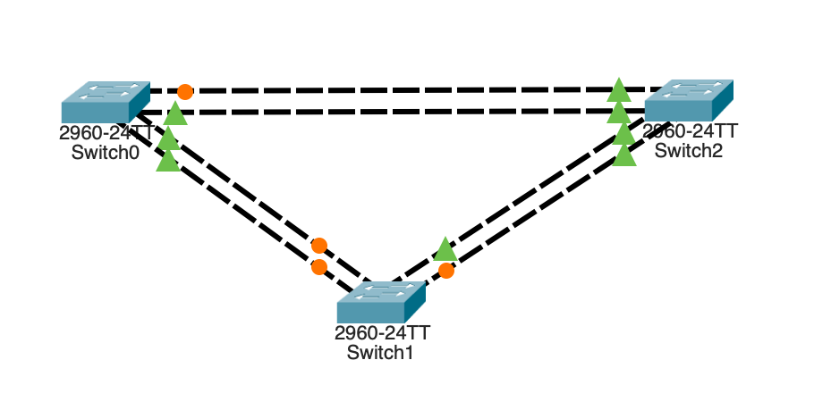

# Лабораторная работа 7. Развертывание коммутируемой сети с резервными каналами
### Топология

### Таблица адресации
| Устройство  | Интерфейс   |  IP-адрес            | Маска подсети       | 
|-------------|-------------|----------------------|---------------------|
| S1          | VLAN1       | 192.168.1.1          | 255.255.255.0       | 
| S2          | VLAN1       | 192.168.1.2          | 255.255.255.0       | 
| S3          | VLAN1       | 192.168.1.3          | 255.255.255.0       | 

### Цели 
#### Часть 1. Создание сети и настройка основных параметров устройства
#### Часть 2. Выбор корневого моста
#### Часть 3. Наблюдение за процессом выбора протоколом STP порта, исходя из стоимости портов
#### Часть 4. Наблюдение за процессом выбора протоколом STP порта, исходя из приоритета портов

### Решение:
#### Часть 1. Создание сети и настройка основных параметров устройства
#### Шаг 1:	Создайте сеть согласно топологии

