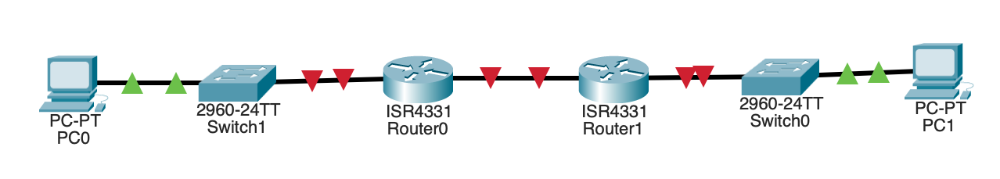

# Лабораторная работа 8. Реализация DHCPv4 
### Топология


### Таблица адресации
| Устройство  | Интерфейс   |  IPv6-адрес          | Маска подсети.      | Шлюз по умолчанию |
|-------------|-------------|----------------------|---------------------|-------------------|
| R1          | G0/0/0      | 10.0.0.1             | 255.255.255.252     | -                 |
|             | G0/0/1      | -                    | -                   |                   |
|             | G0/0/1.100  | 192.168.1.1          | 255.255.255.192     |                   |
|             | G0/0/1.200  | 192.168.1.65         | 255.255.255.224     |                   |
|             | G0/0/1.1000 | -                    | -                   |                   |
| R2          | G0/0        | 10.0.0.2             | 255.255.255.252     | -                 |
|             | G0/0/1      | 192.168.1.97         | 255.255.255.240     |                   |
| S1          | VLAN200     | 192.168.1.66         | 255.255.255.224     | 192.168.1.65      |
| S2          | VLAN1       | 192.168.1.98         | 255.255.255.240     | 192.168.1.97      | 
| PC-A        | NIC         | DHCP                 | DHCP                | DHCP              |
| PC-B        | NIC         | DHCP                 | DHCP                | DHCP              |


### Таблица VLAN

| VLAN        | Имя         |  Назначенный интерфейс | 
|-------------|-------------|------------------------|
| 1           | Нет         | S2: F0/18              | 
| 100         | Клиенты     | S1: F0/6               |  
| 200         | Управление  | S1: VLA200             | 
| 999         | Parking_lot | S1: F0/1-4, F0/7-24, G0/1-2 | 
| 1000        | Собственная | -                      | 

### Задачи 
#### Часть 1. Создание сети и настройка основных параметров устройства
#### Часть 2. Настройка и проверка двух серверов DHCPv4 на R1
#### Часть 3. Настройка и проверка DHCP-ретрансляции на R2

### Решение
#### Часть 1.	Создание сети и настройка основных параметров устройства
#### Шаг 1. Создание схемы адресации
Подсеть A: 192.168.1.0/26, первый IP для R1 G0/0/1.100 — 192.168.1.1.   
Подсеть B: 192.168.1.64/27, первый IP для R1 G0/0/1.200 — 192.168.1.65; второй IP для S1 VLAN 200 — 192.168.1.66; шлюз по умолчанию S1 — 192.168.1.65.   
Подсеть C: 192.168.1.96/28, первый IP для R2 G0/0/1 — 192.168.1.97.   
#### Шаг 2. Создайте сеть согласно топологии


### Шаг 3. Произведите базовую настройку маршрутизаторов.

```
Router> enable
Router# conf t
Router(config)# hostname R1
R1(config)# no ip domain-lookup
R1(config)# enable secret class
R1(config)# line console 0
R1(config-line)# password cisco
R1(config-line)# login
R1(config-line)# exit
R1(config)# line vty 0 4
R1(config-line)# password cisco
R1(config-line)# login
R1(config-line)# exit
R1(config)# service password-encryption
R1(config)# banner motd # NO ENTER !!! #
R1(config)# exit
R1# clock set 12:00:00 25 Oct 2026
R1# write
```
Для маршрутизатора R2 выполнена аналогичная настройка.

### Шаг 4.	Настройка маршрутизации между сетями VLAN на маршрутизаторе R1
a.	Активируйте интерфейс G0/0/1 на маршрутизаторе.
```
enable
conf t
interfece g0/0/1
no sh
```
b.	Настройте подинтерфейсы для каждой VLAN в соответствии с требованиями таблицы IP-адресации. Все субинтерфейсы используют инкапсуляцию 802.1Q и назначаются первый полезный адрес из вычисленного пула IP-адресов. Убедитесь, что подинтерфейсу для native VLAN не назначен IP-адрес. Включите описание для каждого подинтерфейса.
```

```
