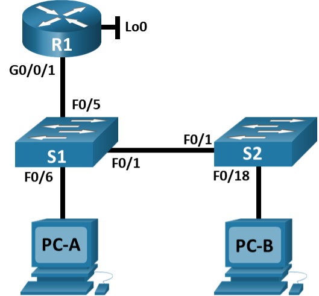
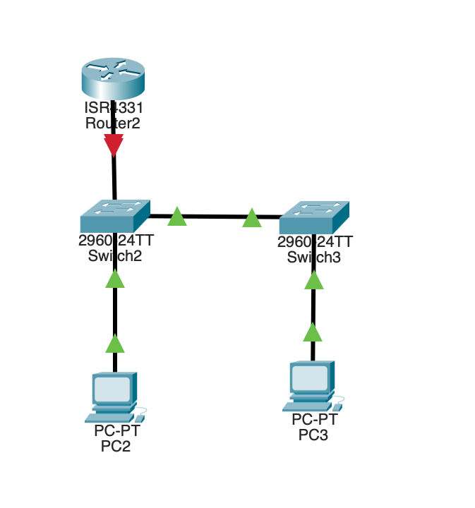

# Лабораторная работа 9 - Конфигурация безопасности коммутатора 
### Топология


### Таблица адресации
| Устройство  | Интерфейс   |  IP-адрес            | Маска подсети       | 
|-------------|-------------|----------------------|---------------------|
| R1          | G0/0/0      | 192.168.10.1         |  255.255.255.0      |
|             | Loop0       | 10.10.1.1            |  255.255.255.0      |
| S1          | VLAN10      | 192.168.10.201       |  255.255.255.0      |
| S2          | VLAN10      | 192.168.10.202       |  255.255.255.0      |
| PC-A        | NIC         | DHCP                 |  255.255.255.0      |
| PC-B        | NIC         | DHCP                 |  255.255.255.0      |

### Задачи
### Часть 1. Настройка основного сетевого устройства
### Часть 2. Настройка сетей VLAN
### Часть 3: Настройки безопасности коммутатора.

### Решение
### Часть 1. Настройка основного сетевого устройства
### Шаг 1. Создайте сеть


### Шаг 2. Настройте маршрутизатор R1.

a.	Загрузите следующий конфигурационный скрипт на R1.

```
enable
configure terminal
hostname R1
no ip domain lookup
ip dhcp excluded-address 192.168.10.1 192.168.10.9
ip dhcp excluded-address 192.168.10.201 192.168.10.202
ip dhcp relay information trust-all
ip dhcp pool Students
 network 192.168.10.0 255.255.255.0
 default-router 192.168.10.1
 domain-name CCNA2.Lab-11.6.1
interface Loopback0
 ip address 10.10.1.1 255.255.255.0
interface GigabitEthernet0/0/1
 description Link to S1
 ip address 192.168.10.1 255.255.255.0
 no shutdown
line con 0
 logging synchronous
 exec-timeout 0 0
```
b.	Проверьте текущую конфигурацию на R1, используя следующую команду:

```
R1# show ip interface brief
```
### Шаг 3. Настройка и проверка основных параметров коммутатора

Для S1:
```
enable
configure terminal
hostname S1
no ip domain-lookup
interface f0/5
 description Link to R1
 exit
interface f0/6
 description PC-A
 exit
interface f0/1
 description Trunk to S2
 exit
ip default-gateway 192.168.10.1
vlan 10
 name MANAGEMENT
 exit
interface vlan 10
 ip address 192.168.10.201 255.255.255.0
 no shutdown
 exit
interface f0/5
 switchport mode access
 switchport access vlan 10
 exit
interface f0/6
 switchport mode access
 switchport access vlan 10
 exit
interface f0/1
 switchport mode trunk
 switchport trunk native vlan 10
 switchport trunk allowed vlan 10
 exit
exit
write
```
Для S2:

```
enable
configure terminal
hostname S2
no ip domain-lookup
interface f0/1
 description Trunk to S1
 exit
interface f0/18
 description PC-B
 exit
ip default-gateway 192.168.10.1
vlan 10
 name MANAGEMENT
 exit
interface vlan 10
 ip address 192.168.10.202 255.255.255.0
 no shutdown
 exit
interface f0/1
 switchport mode trunk
 switchport trunk native vlan 10
 switchport trunk allowed vlan 10
 exit
interface f0/18
 switchport mode access
 switchport access vlan 10
 exit
exit
write

```

### Часть 2. Настройка сетей VLAN на коммутаторах.
### Шаг 1. Сконфигруриуйте VLAN 10.
### Шаг 2. Сконфигруриуйте SVI для VLAN 10.
### Шаг 3. Настройте VLAN 333 с именем Native на S1 и S2.
### Шаг 4. Настройте VLAN 999 с именем ParkingLot на S1 и S2.
Для S1:

```
enable
configure terminal
vlan 10
 name Management
exit
vlan 333
 name Native
exit
vlan 999
 name ParkingLot
exit
interface vlan 10
 description Management SVI
 ip address 192.168.10.201 255.255.255.0
 no shutdown
exit
ip default-gateway 192.168.10.1
end
write 

```

Для S2:
```
enable
configure terminal
vlan 10
name Management
exit
vlan 333
name Native
exit
vlan 999
name ParkingLot
exit
interface vlan 10
description Management SVI
ip address 192.168.10.202 255.255.255.0
no shutdown
exit
ip default-gateway 192.168.10.1
end
write 
```

### Часть 3. Настройки безопасности коммутатора.
a.	Настройте все магистральные порты Fa0/1 на обоих коммутаторах для использования VLAN 333 в качестве native VLAN.

Для S1:
```
enable
configure terminal
interface FastEthernet0/1
description Link to S2
switchport mode trunk
switchport trunk native vlan 333
exit
end
```
Для S2:
```
enable
configure terminal
interface FastEthernet0/1
description Link to S1
switchport mode trunk
switchport trunk native vlan 333
exit
end
```
c.	Отключить согласование DTP F0/1 на S1 и S2. 
Для S1 и S2:
```
configure terminal
interface FastEthernet0/1
 switchport nonegotiate
exit
end
```
Шаг 2. Настройка портов доступа
Для S1:
```
configure terminal
interface FastEthernet0/5
 description Link to R1
 switchport mode access
 switchport access vlan 10
exit
interface FastEthernet0/6
 description Link to PC-A
 switchport mode access
 switchport access vlan 10
exit
end
```
Для S2:
```
configure terminal
interface FastEthernet0/18
 description Link to PC-B
 switchport mode access
 switchport access vlan 10
exit
end
```
### Шаг 3. Безопасность неиспользуемых портов коммутатора
### a.	На S1 и S2 переместите неиспользуемые порты из VLAN 1 в VLAN 999 и отключите неиспользуемые порты.

Для S1:
```
configure terminal
interface range FastEthernet0/2-4, FastEthernet0/7-24, GigabitEthernet0/1-2
 switchport mode access
 switchport access vlan 999
 shutdown
exit
end
```
Для S2:
```
configure terminal
interface range FastEthernet0/2-17, FastEthernet0/19-24, GigabitEthernet0/1-2
 switchport mode access
 switchport access vlan 999
 shutdown
exit
end
```
### Шаг 4. Документирование и реализация функций безопасности порта.
```
show port-security interface f0/6
```
```
Port Security              : Disabled
Port Status                : Secure-down
Violation Mode             : Shutdown
Aging Time                 : 0 mins
Aging Type                 : Absolute
SecureStatic Address Aging : Disabled
Maximum MAC Addresses      : 1
Total MAC Addresses        : 0
Configured MAC Addresses   : 0
Sticky MAC Addresses       : 0
Last Source Address:Vlan   : 0000.0000.0000:0
Security Violation Count   : 0
```
b.	На S1 включите защиту порта на F0 / 6 со следующими настройками:
```
configure terminal
interface FastEthernet0/6
 switchport port-security
 switchport port-security maximum 3
 switchport port-security violation restrict
 switchport port-security aging time 60
 switchport port-security aging type inactivity
exit
end
```
c.	Verify port security on S1 F0/6.
```
show port-security interface f0/6
```
```
Port Security              : Enabled
Port Status                : Secure-up
Violation Mode             : Restrict
Aging Time                 : 60 mins
Aging Type                 : Absolute
SecureStatic Address Aging : Disabled
Maximum MAC Addresses      : 3
Total MAC Addresses        : 0
Configured MAC Addresses   : 0
Sticky MAC Addresses       : 0
Last Source Address:Vlan   : 0000.0000.0000:0
Security Violation Count   : 0
```
d.	Включите безопасность порта для F0 / 18 на S2. Настройте каждый активный порт доступа таким образом, чтобы он автоматически добавлял адреса МАС, изученные на этом порту, в текущую конфигурацию.
```
enable
configure terminal
interface FastEthernet0/18
 switchport port-security
 switchport port-security mac-address sticky
exit
end
```

e.	Настройте следующие параметры безопасности порта на S2 F / 18:
```
enable
configure terminal
interface FastEthernet0/18
 switchport port-security maximum 2
 switchport port-security violation protect
 switchport port-security aging time 60
exit
end
```
### Шаг 5. Реализовать безопасность DHCP snooping.
a.	На S2 включите DHCP snooping и настройте DHCP snooping во VLAN 10.
```
enable
configure terminal
ip dhcp snooping
ip dhcp snooping vlan 10
exit
end
```

b.	Настройте магистральные порты на S2 как доверенные порты.
```
enable
configure terminal
interface FastEthernet0/1
 ip dhcp snooping trust
exit
end
```

c.	Ограничьте ненадежный порт Fa0/18 на S2 пятью DHCP-пакетами в секунду.
```
enable
configure terminal
interface FastEthernet0/18
 ip dhcp snooping limit rate 5
exit
end
```


