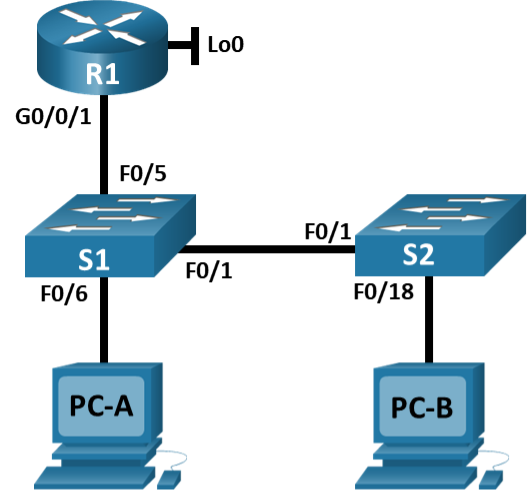
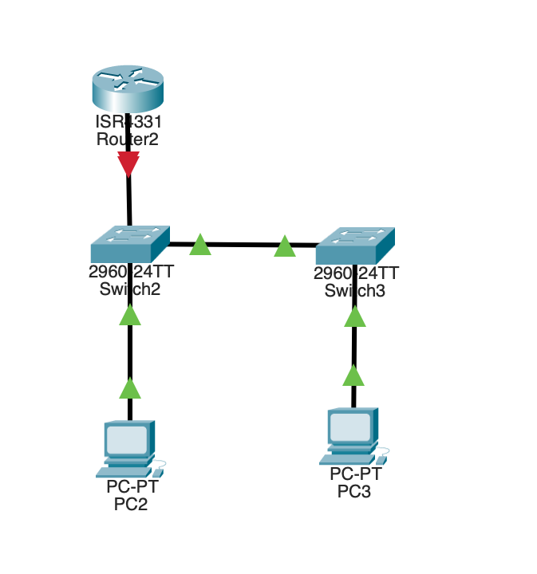

# Лабораторная работа 9 - Конфигурация безопасности коммутатора 
### Топология


### Таблица адресации
| Устройство  | Интерфейс   |  IP-адрес            | Маска подсети       | 
|-------------|-------------|----------------------|---------------------|
| R1          | G0/0/0      | 192.168.10.1         |  255.255.255.0      |
|             | Loop0       | 10.10.1.1            |  255.255.255.0      |
| S1          | VLAN10      | 192.168.10.201       |  255.255.255.0      |
| S2          | VLAN10      | 192.168.10.202       |  255.255.255.0      |
| PC-A        | NIC         | DHCP                 |  255.255.255.0      |
| PC-B        | NIC         | DHCP                 |  255.255.255.0      |

### Задачи
### Часть 1. Настройка основного сетевого устройства
### Часть 2. Настройка сетей VLAN
### Часть 3: Настройки безопасности коммутатора.

### Решение
### Часть 1. Настройка основного сетевого устройства
### Шаг 1. Создайте сеть


### Шаг 2. Настройте маршрутизатор R1.

a.	Загрузите следующий конфигурационный скрипт на R1.

```
enable
configure terminal
hostname R1
no ip domain lookup
ip dhcp excluded-address 192.168.10.1 192.168.10.9
ip dhcp excluded-address 192.168.10.201 192.168.10.202
ip dhcp relay information trust-all
ip dhcp pool Students
 network 192.168.10.0 255.255.255.0
 default-router 192.168.10.1
 domain-name CCNA2.Lab-11.6.1
interface Loopback0
 ip address 10.10.1.1 255.255.255.0
interface GigabitEthernet0/0/1
 description Link to S1
 ip address 192.168.10.1 255.255.255.0
 no shutdown
line con 0
 logging synchronous
 exec-timeout 0 0
```
